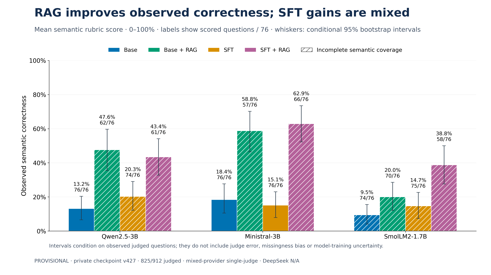
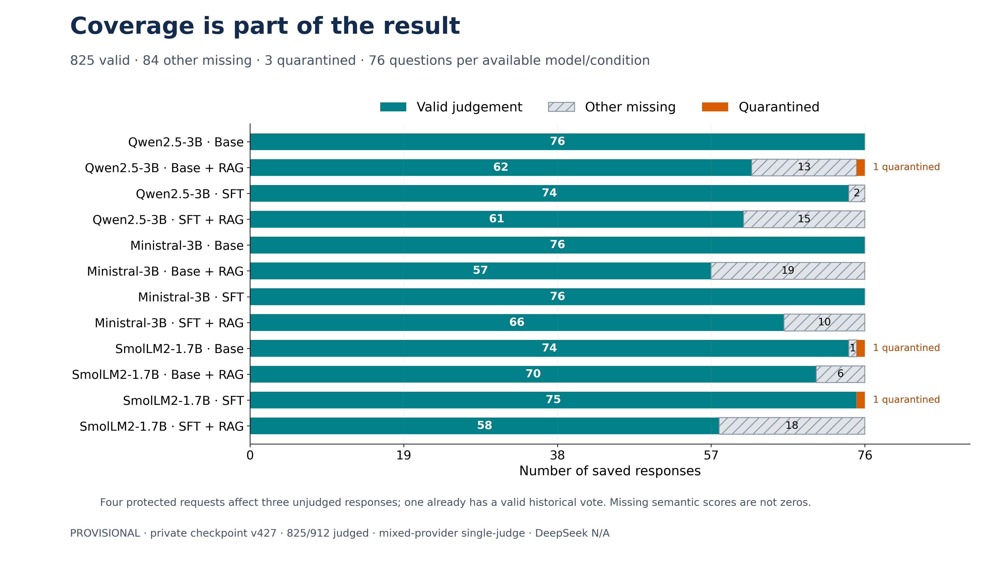

# Small Language Models for UK Motor Insurance Policy-Grounded Question Answering

**Tech Mahindra Makers Lab · D1000 experiment · presentation: 3 November 2026**

Can relatively small language models answer UK motor insurance questions reliably, and how do supervised fine-tuning (SFT) and retrieval-augmented generation (RAG) affect correctness, grounding and refusal behaviour?

**Latest verified evaluation snapshot: private checkpoint v427 — PARTIAL, 825/912 valid semantic judgements (90.5%).** All 912 model responses and three trained adapters are saved and verified. Of the 87 missing semantic judgements, **84 exhausted Gemini’s existing validation-attempt bound; 3 are quarantined**. Four protected transport-uncertain requests are retained, including one response already covered by a historical valid vote. No unknown request is replayed or reassigned. This is not a completed 912-response semantic evaluation.

**Private reporting checkpoint v428** independently preserves the same 825 judged responses plus the canonical tables, reporting code and 18 figure files. The figure/table provenance remains the verified evaluation snapshot 427; checkpoint 428 adds reporting artifacts, not new votes.

The D1000 findings below supersede the October 20 interim experiment as this repository’s primary results. Historical data, protocols and evidence remain preserved under [Historical experiments](#historical-experiments).

## Research questions and conditions

The frozen 76-question benchmark is reused across three completed model families and four conditions: **3 × 4 × 76 = 912 responses**. It contains 67 answerable and nine unanswerable questions. The same retrieved passages are used in the two RAG arms. No benchmark-based model selection is permitted.

| Condition | Student weights | Student-visible policy evidence |
|---|---|---|
| Base | Pinned instruct model | None |
| Base + RAG | Same base model | Fixed retrieved passages |
| SFT | QLoRA-adapted model | None |
| SFT + RAG | Same adapted model | The same fixed passages |

## Dataset and training

D1000 contains **1,000 source QA records: 462 independently verified and 538 explicitly unverified**. This is mixed-quality data, not 1,000 verified training examples. Only **834 eligible converted records** entered the frozen split: **751 training / 83 validation**. The split is grouped, seed 0, for validation logging; the fixed final training epoch is used. Human review remains uncompleted. [Dataset export and training audit](cloud/d1000/README.md).

QLoRA retains NF4/double quantisation, LoRA rank 16, alpha 32, dropout 0.05, learning rate 1e-4, two epochs, batch size 1, accumulation 8 and a 2,048-token training budget. Generation is greedy, seed 0, up to 700 new tokens within an 8,192-token total budget. Targets and evidence are not silently truncated. The frozen benchmark is excluded from training/selection. [Exact model revisions and configuration](cloud/d1000/config.json).

## Model completion

| Model family | Exact student checkpoint | D1000 status |
|---|---|---|
| Qwen2.5-3B | `Qwen/Qwen2.5-3B-Instruct` | Adapter verified; all four conditions, 304 responses saved |
| Ministral-3B | `unsloth/Ministral-3-3B-Instruct-2512-bnb-4bit` | Adapter verified; all four conditions, 304 responses saved |
| SmolLM2-1.7B | `HuggingFaceTB/SmolLM2-1.7B-Instruct` | Adapter verified; all four conditions, 304 responses saved |
| DeepSeek-R1-Distill-Qwen-1.5B | `deepseek-ai/DeepSeek-R1-Distill-Qwen-1.5B` | **Unavailable:** prompt-prefix masking incompatibility; four conditions N/A |

The D1000 Qwen3B and Unsloth Ministral checkpoints are distinct from the separate October 20 Qwen1.5B/official-Ministral screening population. No DeepSeek result is inferred or fabricated.

## Evaluation protocol and coverage

The owner-authorised **`d1000-single-judge-fast-v1`** protocol requires one valid semantic judgement per response. Original judges: Groq `openai/gpt-oss-120b` and Gemini `gemini-3.5-flash-lite`; both passed all nine unchanged fictional calibration cases. Historical ties use Groq first; otherwise an existing valid vote is reused. Existing votes, the frozen rubric, citation validation and request journals are retained. No new paired-judgement collection or cross-judge agreement analysis is performed.

There are **67 Groq and 806 Gemini saved votes**, including 48 historical overlaps. Deterministic selection uses **67 Groq + 758 Gemini = 825** responses. These are mixed-provider single-judge descriptive results, not dual-judge consensus or human-reviewed accuracy. A Gemini3.1 fallback failed calibration (8/9) and contributes **zero** research votes.

Every accepted semantic result passes the original schema, score/null constraints, citation occurrence and verbatim-span validation. Missing scores remain missing. Deterministic refusal/citation/parse metrics use all saved responses independently of semantic API availability. Strict journal and cache identities, archive hash, 80-file preservation manifest, all 912 responses, adapters and writer lease were reverified before aggregation.

## Latest verified results — provisional / PARTIAL

| Model | Condition | Correctness¹ | Judged / 76 | Balanced abstention² | Citation support³ | Citation-ID resolution | Parse⁴ | False refusal² |
|---|---|---:|---:|---:|---:|---:|---:|---:|
| Qwen2.5-3B | Base | 13.2% | 76/76 | 49.3% | N/A | N/A | 25.0% | 1.5% |
| Qwen2.5-3B | Base + RAG | 47.6% | 62/76 | 50.0% | 56.6% | 88.9% | 69.7% | 0.0% |
| Qwen2.5-3B | SFT | 20.3% | 74/76 | 50.0% | N/A | N/A | 43.4% | 0.0% |
| Qwen2.5-3B | SFT + RAG | 43.4% | 61/76 | 58.9% | 74.5% | 92.4% | 92.1% | 4.5% |
| Ministral-3B | Base | 18.4% | 76/76 | 45.4% | N/A | N/A | 36.8% | 31.3% |
| Ministral-3B | Base + RAG | 58.8% | 57/76 | 60.4% | 91.4% | 81.2% | 75.0% | 1.5% |
| Ministral-3B | SFT | 15.1% | 76/76 | 54.1% | N/A | N/A | 89.5% | 80.6% |
| Ministral-3B | SFT + RAG | 62.9% | 66/76 | 83.7% | 90.4% | 100.0% | 96.1% | 10.4% |
| SmolLM2-1.7B | Base | 9.5% | 74/76 | 50.0% | N/A | N/A | 15.8% | 0.0% |
| SmolLM2-1.7B | Base + RAG | 20.0% | 70/76 | 50.0% | N/A | 100.0% | 1.3% | 0.0% |
| SmolLM2-1.7B | SFT | 14.7% | 75/76 | 50.0% | N/A | N/A | 9.2% | 0.0% |
| SmolLM2-1.7B | SFT + RAG | 38.8% | 58/76 | 48.5% | 64.9% | 83.3% | 71.1% | 3.0% |

¹ Mean rubric score (0 / 0.5 / 1), conditional on valid non-null semantic judgements; missing is not zero. See canonical table for score sums, denominators and conditional bootstrap intervals.
² Deterministic metrics use all 76 saved responses: 67 answerable and 9 unanswerable. Balanced abstention = ½(answerable non-refusal rate + unanswerable refusal rate).
³ Citation support uses only supplied, scored citation occurrences; denominators vary. No-RAG is N/A. SmolLM Base+RAG has one resolving ID but zero scored support occurrences, so support is N/A.
⁴ The inherited parse metric recognises a refusal or a parseable citation. It is **not** a measure of structured JSON generation compliance.

DeepSeek’s four conditions are unavailable (N/A), excluded from the 912-response population.


### Findings supported by this snapshot

- **RAG raises observed correctness in each model family, with and without SFT** in this snapshot. Semantic coverage differs between arms; these are observed-subset comparisons, not unbiased population effects.
- **Highest observed correctness: Ministral-3B SFT + RAG, 62.9%** (41.5 rubric score points / 66 judged questions; conditional question-bootstrap interval 52.3%–73.5%). Its balanced abstention is 83.7% across all 76 saved answers. This is an observed ranking, not a statistically established universal winner.
- **SFT is not a uniform correctness improvement.** Qwen2.5-3B Base→SFT: 13.2%→20.3%; Qwen2.5-3B Base + RAG→SFT + RAG: 47.6%→43.4%; Ministral-3B Base→SFT: 18.4%→15.1%; SmolLM2-1.7B Base + RAG→SFT + RAG: 20.0%→38.8%. [Paired common-question sensitivity analysis](reports/d1000_final/sft_effects.json) reports matched-question deltas and intervals separately.
- **Refusal sensitivity can hide over-refusal.** Ministral SFT refuses 8/9 unanswerable questions but also 54/67 answerable ones (80.6% false refusal). With RAG this becomes 7/9 appropriate refusals and 7/67 false refusals; balanced abstention is 83.7%.
- **Citation matching is not semantic support.** Ministral SFT+RAG resolves 71/71 IDs, while its available semantic citation-support mean is 90.4% across 57 scored occurrences. SmolLM Base+RAG has only one resolving ID and zero scored support occurrences; its resolution is not a grounding-reliability finding.
- **Lowest observed correctness: SmolLM2-1.7B Base, 9.5% (74/76 judged).** A balanced-abstention score of 50% can result from answering every question and refusing none.

## Presentation figures

All figures are 16:9, exported as4800×2700 PNG, editable vector SVG and vector PDF. Values come from the canonical aggregate table; no manually transcribed plot values are used.





| Figure | Intended slide | PNG / SVG / PDF |
|---|---|---|
| 1. Semantic correctness | Main model/condition comparison, score coverage and conditional intervals | [PNG](reports/d1000_final/figures/01_semantic_correctness.png) · [SVG](reports/d1000_final/figures/01_semantic_correctness.svg) · [PDF](reports/d1000_final/figures/01_semantic_correctness.pdf) |
| 2. SFT effect | Positive and negative Base→SFT changes, with/without RAG | [PNG](reports/d1000_final/figures/02_sft_effect.png) · [SVG](reports/d1000_final/figures/02_sft_effect.svg) · [PDF](reports/d1000_final/figures/02_sft_effect.pdf) |
| 3. Refusal behaviour | Appropriate refusal, false refusal and their balanced score | [PNG](reports/d1000_final/figures/03_refusal_abstention.png) · [SVG](reports/d1000_final/figures/03_refusal_abstention.svg) · [PDF](reports/d1000_final/figures/03_refusal_abstention.pdf) |
| 4. Citation reliability | Metadata resolution versus semantic evidence support | [PNG](reports/d1000_final/figures/04_citation_reliability.png) · [SVG](reports/d1000_final/figures/04_citation_reliability.svg) · [PDF](reports/d1000_final/figures/04_citation_reliability.pdf) |
| 5. Coverage | Valid, missing and quarantined responses across 12 conditions | [PNG](reports/d1000_final/figures/05_coverage.png) · [SVG](reports/d1000_final/figures/05_coverage.svg) · [PDF](reports/d1000_final/figures/05_coverage.pdf) |
| 6. Results heatmap | Compact overview with N/A and semantic sample sizes | [PNG](reports/d1000_final/figures/06_results_heatmap.png) · [SVG](reports/d1000_final/figures/06_results_heatmap.svg) · [PDF](reports/d1000_final/figures/06_results_heatmap.pdf) |

[Slide-ready presentation summary](reports/d1000_final/presentation_summary.md) · [Reporting guide](reports/d1000_final/README.md).

## Reproduction

Public reporting requires only aggregate results. Raw QA, policy wording, reference answers, model responses, adapter weights, vote journals and quota entries remain private.

```bash
python -m pip install -r reports/d1000_final/requirements.txt
python scripts/build_d1000_results.py
python scripts/plot_d1000_results.py
python scripts/render_d1000_readme.py
python -m pytest -q tests/test_d1000_reporting.py
```

The input [verified_aggregates.json](reports/d1000_final/verified_aggregates.json) was generated inside the approved private Colab VM from the independently readback archive. The canonical [metrics_summary.json](reports/d1000_final/metrics_summary.json) and [CSV](reports/d1000_final/metrics_summary.csv) contain model, condition, metric, value, numerator, denominator, coverage, uncertainty and checkpoint provenance. [Coverage/provenance](reports/d1000_final/coverage_summary.json), [figure hashes](reports/d1000_final/figures/manifest.json) and the cloud-only [aggregate builder](cloud/single_judge_fast/reporting.py) make regeneration traceable. Private runtime aggregation requires approved credentials and a stopped, exclusively leased coordinator; the local scripts make no API calls.

Evaluation/training modules remain in [cloud/d1000](cloud/d1000/README.md); secure Colab restoration in [cloud/recovery_v1](cloud/recovery_v1/README.md); single-judge continuation in [cloud/single_judge_fast](cloud/single_judge_fast/README.md). Reporting does not start training, inference or generation. Do not use Run all on historical cloud notebooks.

## Limitations and remaining work

This snapshot is **PARTIAL**, not fully judged or eligible-complete. 84 currently missing responses exhausted Gemini’s bounded validation attempts; 3 unjudged responses are protected by unknown outcomes. Missingness is concentrated in RAG conditions and may bias semantic comparisons. A valid judge record is not the same as factual ground truth. There is no completed human review, no multi-seed training uncertainty and no independent human/judge agreement assessment. Conditional bootstrap intervals do not account for judge disagreement or missingness and are not evidence of significant universal model differences.

D1000 mixes verified and unverified source examples, and only its eligible converted subset was used. The frozen test has 76 questions, including only 9 unanswerable items. Citation-support denominators are scored occurrences, whereas resolution uses all emitted IDs; they must not be conflated. The inherited parse metric is citation/refusal recognition rather than JSON structured-output compliance. DeepSeek’s unavailable arm remains N/A.

All four unknown requests and quota reservations are preserved. Groq’s recorded quota boundary is 2 November 2026 **18:40:33UTC**; it cannot be used early. Actual prompt/token capacity and writer ownership must pass again before any continuation. Gemini’s known-invalid bounds and failed third-model calibration must not be reset merely to obtain coverage. [Current run receipt](reports/d1000_final/run_receipt.json).

The remaining-capacity audit at snapshot 427 found **19 non-quarantined tasks that fit Groq’s 8,000-token/minute reservation limit and 65 that exceed it**. Its current 6,343-token daily balance is below the smallest remaining 7,113-token reservation. All four protected errors are HTTP503 with no durable raw reply. No prompt is truncated and no attempt bound is reset to obtain coverage. [Safe capacity audit](reports/d1000_final/capacity_audit.json).

## Private research assets

Authorised account access is required; no private records are embedded in this repository.

- [Private D1000 training export](https://www.kaggle.com/datasets/scarletthe0116/uk-motor-qa-d1000-training/versions/1).
- [Private frozen evaluation assets](https://www.kaggle.com/datasets/scarletthe0116/uk-motor-frozen-evaluation-v2/versions/1).
- [Private results checkpoint 427](https://www.kaggle.com/datasets/scarletthe0116/uk-motor-d1000-models-results/versions/427).
- [Private CPU Colab evaluation](https://colab.research.google.com/drive/1g_rir-DPeeoZG3fAqNZxoY_JRXuRcbbD).
- [Working research PR #2](https://github.com/Peanut-butter116/uk-motor-insurance-dslm/pull/2); no merge is implied by this reporting update.

## Historical experiments

The earlier 409-record interim dataset, October 20 screening results, three-repeat-judge protocol and 21-seed SFT experiments are historical populations, not the current D1000 results. They remain available in [October 20 experiment](experiments/2026-10-20/README.md), [archive index](archive/README.md) and [exact predecessor README snapshots](archive/d1000-predecessor/README.md), with original manifests and hashes preserved. Historical three-vote results have not been overwritten or relabelled as the D1000 single-judge experiment.
